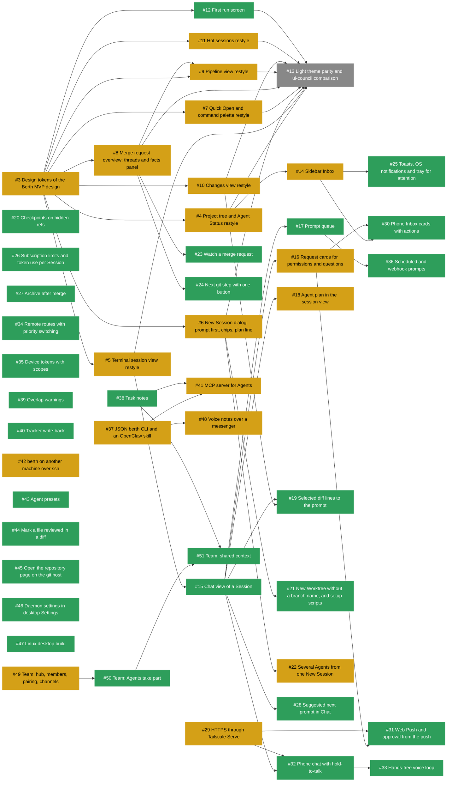

# Issue status

Generated by `node scripts/issue-status.mjs` from GitHub issues and the `Fixes` / `Refs` lines of commits on `main`. An arrow points from a blocker to the issue it blocks.

closed 0, done on main 29, partial 19, not started 1

