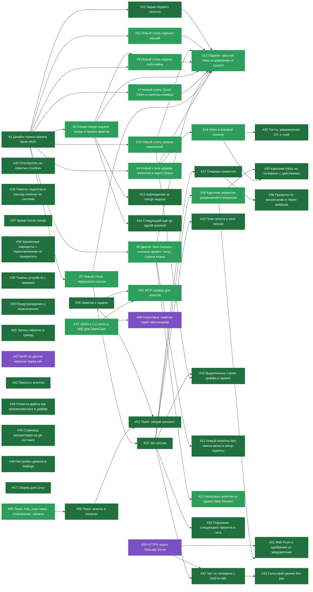

# Статус задач

Файл собирает `node scripts/issue-status.mjs` из задач GitHub и строк `Fixes` / `Refs` в коммитах `main`. Русские названия задач лежат в `scripts/issue-titles.ru.json`, задача без перевода показывается с английским названием. Стрелка ведёт от блокирующей задачи к заблокированной.

Закрыто 31, сделано на main 15, начато 0, отложено 3, не начато 0.

Цвета: тёмно-зелёный закрыто, зелёный сделано на main, жёлтый начато, фиолетовый отложено (код есть, для проверки нужно внешнее: телефон, хост или сервис), серый не начато.

